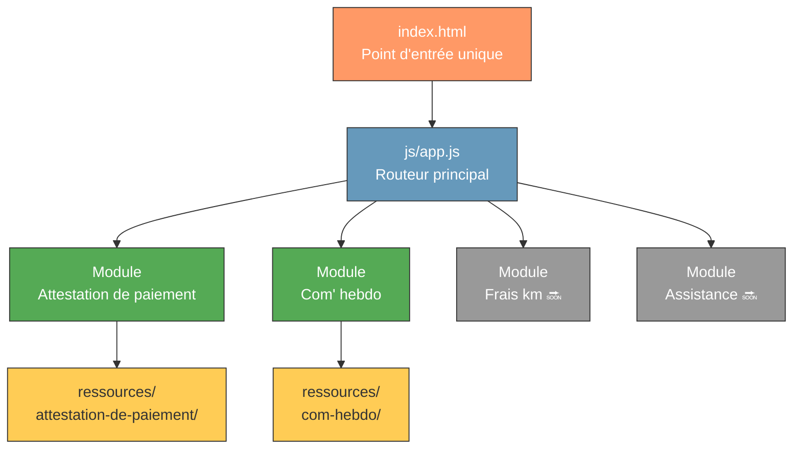
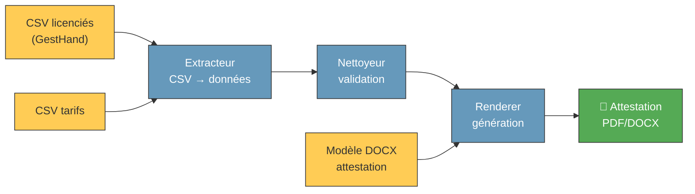
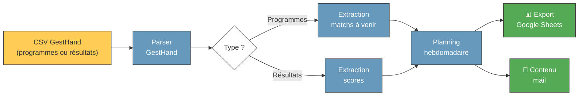

# 🏗️ Architecture du projet Super Chapelaine

## Vue d'ensemble

Super Chapelaine est une **application web statique mono-page (SPA)** qui
regroupe plusieurs outils de gestion pour le club de handball La Chapelaine.

L'architecture repose sur des principes simples :
- **Zéro backend** : tout s'exécute dans le navigateur
- **JavaScript vanilla** : ES Modules natifs, aucun bundler
- **CSS natif** : variables CSS pour la cohérence visuelle
- **Modularité** : chaque outil est un module indépendant

---

## Architecture des modules



---

## Flux de données — Attestation de paiement



---

## Flux de données — Communication hebdomadaire



---

## Structure des répertoires

```
super-chapelaine/
│
├── index.html                  ← SPA : point d'entrée unique
├── Makefile                    ← Commandes du projet
├── AGENTS.md                   ← Instructions agents IA
├── README.md                   ← Documentation générale
│
├── js/                         ← Code JavaScript (ES Modules)
│   ├── app.js                  ← Initialisation et routage
│   ├── config/                 ← Constantes, configuration
│   ├── renderers/              ← Rendu DOM et mise en page
│   ├── extracteurs/            ← Lecture et extraction de données
│   ├── parsers/                ← Analyse de formats spécifiques
│   └── nettoyeurs/             ← Validation et nettoyage
│
├── css/                        ← Styles
│   └── styles.css              ← Variables CSS et styles globaux
│
├── ressources/                 ← Données et modèles
│   ├── attestation-de-paiement/
│   │   ├── tarifs.csv
│   │   ├── modele-licencie-adresse.csv
│   │   ├── exemple-licencies-valide.csv
│   │   └── modele-attestation-de-paiement-chapelaine.docx
│   └── com-hebdo/
│
├── mail/                       ← Scripts utilitaires (mails)
├── matchs/                     ← Scripts utilitaires (matchs)
├── docs/                       ← Documentation
├── .sessions/                  ← Logs des sessions IA
└── .github/
    └── copilot-instructions.md
```

---

## Conventions et décisions techniques

### Variables CSS

Le projet utilise des variables CSS définies dans `css/styles.css` pour
maintenir une identité visuelle cohérente :

| Variable   | Utilisation                         |
|------------|-------------------------------------|
| `--orange` | Couleur principale du club          |
| `--dark`   | Texte et arrière-plans sombres      |
| …          | Voir `css/styles.css` pour la liste |

### Modules JavaScript

- Chaque fichier exporte ses fonctions via `export`
- Les imports utilisent des chemins relatifs avec extension `.js`
- Un module = une responsabilité (extracteur, parser, renderer…)

### Données CSV

- Séparateur : `;` (standard GestHand)
- Encodage : UTF-8
- Parsing côté client uniquement

### Librairies externes

Toute librairie tierce est chargée via CDN dans `index.html`.
Aucune dépendance locale (`node_modules`) n'est utilisée.
